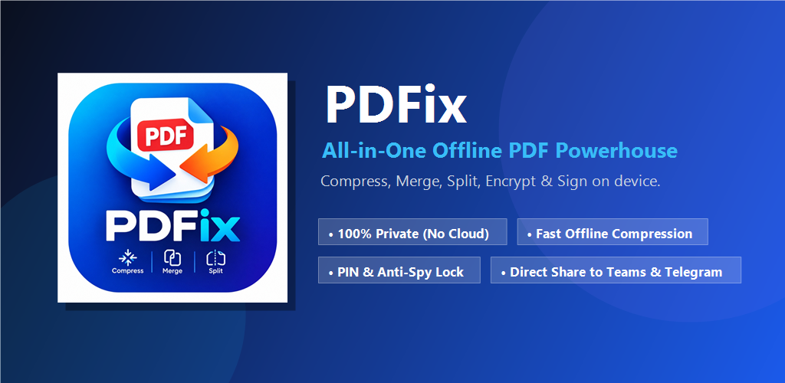
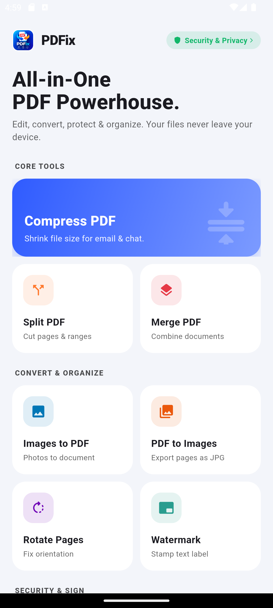
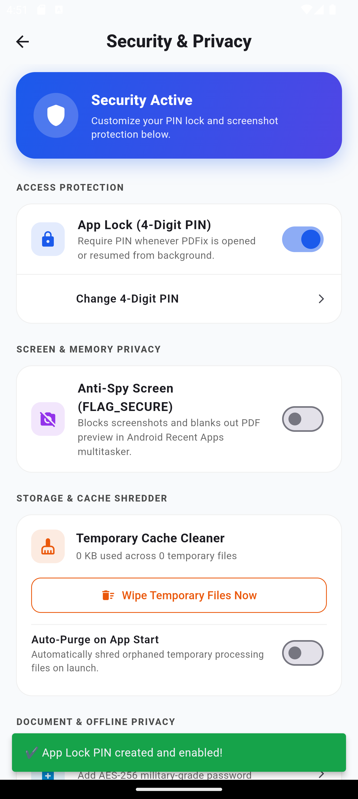
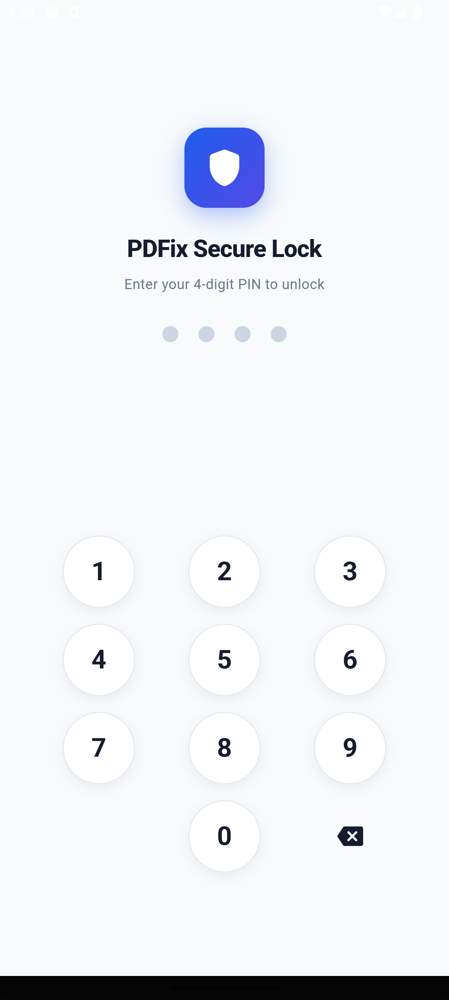
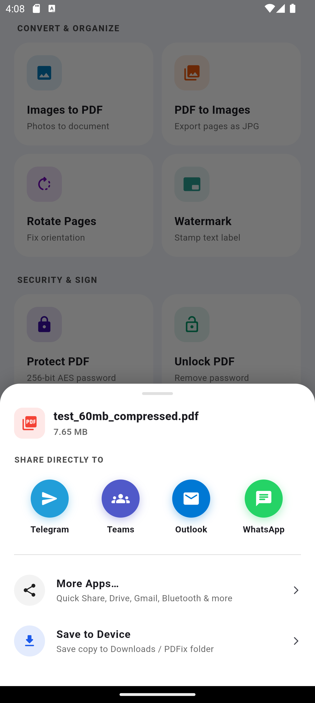

<p align="center">
  
</p>

<h1 align="center">PDFix — All-in-One Offline PDF Powerhouse</h1>

<p align="center">
  <strong>Fast, private, and secure PDF tools right on your Android device. 100% On-Device. Zero Cloud.</strong>
</p>

<p align="center">
  
  
  
  
  
</p>

---

## 🌟 Highlights

- **🔒 100% Offline & Private**: All document processing runs directly on device hardware. Zero telemetry, zero analytics, zero server uploads.
- **⚡ Comprehensive Toolset**:
  - **Compress PDF**: Dramatically reduce file size with Light, Balanced, Strong, and Custom presets.
  - **Merge PDF**: Combine multiple PDFs into a single document with smooth reordering.
  - **Split PDF**: Extract page ranges or individual pages effortlessly.
  - **Images to PDF**: Convert photos (JPEG, PNG) into polished PDF documents.
  - **PDF to Images**: Extract high-resolution images from any page.
  - **Rotate Pages**: Correct document orientation (90°, 180°, 270°).
  - **Watermark & Sign**: Add confidentiality stamps or signature overlays.
  - **Password Encryption**: AES-256 military-grade protection for confidential files.
- **🛡️ Built-in Security & Privacy Suite**:
  - **4-Digit PIN Lock**: Salted SHA-256 cryptographic protection that auto-locks when backgrounded.
  - **Anti-Spy Shield (`FLAG_SECURE`)**: Blocks hardware screenshots and blanks multitask task-switcher previews.
  - **Storage & Cache Shredder**: One-tap wipe of orphaned processing files.
- **🚀 Native Direct Sharing**:
  - One-tap direct sharing to **Telegram**, **Microsoft Teams**, **Microsoft Outlook**, and **WhatsApp** via native Android `FileProvider` intents.

---

## 📱 Screenshots

<p align="center">
  
  
  
  
</p>

---

## 🛠️ Getting Started

### Prerequisites
- [Flutter SDK](https://flutter.dev) (v3.19+ recommended)
- [Android Studio](https://developer.android.com/studio) with Android SDK API 35
- Java Development Kit (JDK 17+)

### Installation
```bash
# Clone the repository
git clone https://github.com/khim1999/pdfix.git
cd pdfix

# Install dependencies
flutter pub get

# Run on connected device or emulator
flutter run
```

---

## 📦 Building for Production

### Build Signed Android App Bundle (for Google Play Store)
```bash
flutter build appbundle --release
```
*Output: `build/app/outputs/bundle/release/app-release.aab`*

### Build Lean Architecture APKs
```bash
flutter build apk --release --split-per-abi
```
*Output: `build/app/outputs/flutter-apk/app-arm64-v8a-release.apk`*

---

## 📄 Privacy Policy

PDFix values user trust above all else. Review our complete [Privacy Policy](PRIVACY_POLICY.md) or [HTML version](PRIVACY_POLICY.html).

---

## 📜 License

This project is licensed under the MIT License — see the [LICENSE](LICENSE) file for details.
